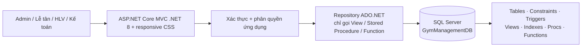
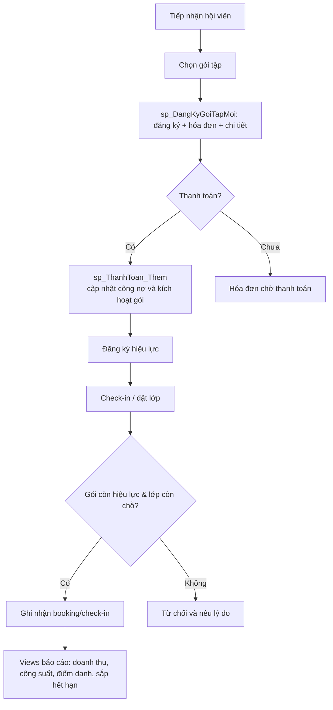
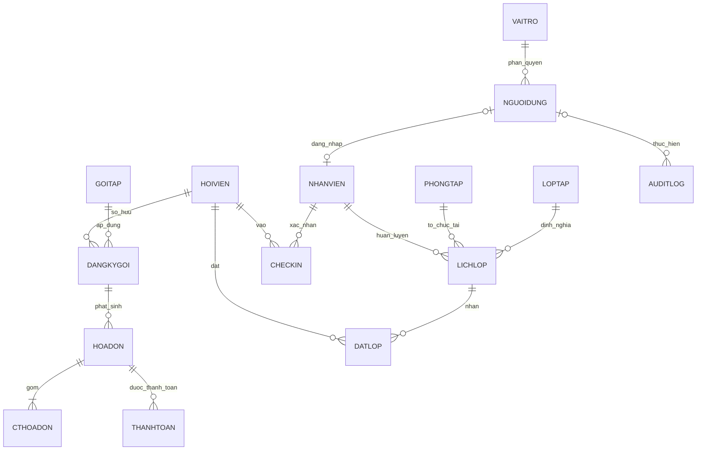

# Kiến trúc và logic tổng thể

## 1. Bài toán và ranh giới

Phòng gym cần một nguồn dữ liệu thống nhất để nhân viên tiếp nhận hội viên, bán/ gia hạn gói tập, thu tiền, sắp lớp, nhận đặt chỗ và kiểm soát lượt vào. Quản lý cần nhìn được doanh thu, số hội viên còn hiệu lực, công suất lớp và lịch sử điểm danh. 

V1 tập trung một cơ sở gym, thanh toán được nhân viên xác nhận (tiền mặt/chuyển khoản/thẻ mô phỏng), không tích hợp cổng thanh toán hay khóa cửa vật lý. Check-in được thực hiện bởi lễ tân từ mã hội viên. Chọn phạm vi này để mọi chức năng có thể demo trực tiếp với SQL Server.

### Đối chiếu với hệ thống quản lý gym thương mại

Phạm vi được rà soát theo nhóm tính năng công khai của [Glofox](https://www.glofox.com/features/), [GymMaster](https://www.gymmaster.com/business/gym-software/) và [Mindbody](https://www.mindbodyonline.com/business/fitness). Đây là đối chiếu sản phẩm để tránh bỏ sót luồng cốt lõi, không phải yêu cầu tích hợp với các nền tảng đó.

| Năng lực chuẩn | V1 hiện tại | Quyết định phạm vi |
|---|---|---|
| Hồ sơ và vòng đời hội viên | CRUD hồ sơ, trạng thái hoạt động, sức khỏe cơ bản, lịch sử gói | Bao phủ đầy đủ cho một cơ sở |
| Membership & billing | Danh mục gói, đăng ký/gia hạn, hóa đơn, thanh toán nhiều lần, công nợ, hủy gói | Bao phủ lõi; chưa tích hợp recurring card/autopay |
| Lịch và đặt lớp | Phòng, loại lớp, HLV, lịch, sức chứa, booking, hàng chờ, hủy và tự đôn hàng chờ | Bao phủ đầy đủ luồng vận hành |
| Access & attendance | Check-in bằng mã hội viên, kiểm tra gói/quota, lịch sử điểm danh | Bao phủ phần mềm; chưa nối khóa cửa/máy quét thật |
| Báo cáo và phân quyền | Dashboard, doanh thu, sắp hết hạn, công suất, điểm danh; Admin/Lễ tân/HLV/Kế toán | Bao phủ đúng rubric và vận hành nội bộ |
| CRM, marketing, ứng dụng hội viên, đa chi nhánh, POS/kho | Chưa triển khai | Roadmap sau V1 vì vượt phạm vi project một cơ sở |

Như vậy, V1 không cố mô phỏng các tích hợp doanh nghiệp chưa thể kiểm chứng. Mọi tính năng được tuyên bố đều có schema, procedure, giao diện và kịch bản test tương ứng.

## 2. Kiến trúc kỹ thuật

- Chuỗi kết nối đặt trong Secret Manager/biến môi trường; appsettings mẫu không chứa mật khẩu.
- DDL và logic SQL là nguồn chuẩn, chạy lại được từ `database/` trên SQL Server.
- Các thao tác ghi nghiệp vụ đi qua Stored Procedure; giao diện không tự ghép SQL ghi dữ liệu.
- Lỗi SQL được bắt tại procedure bằng `TRY...CATCH`, trả lỗi nghiệp vụ rõ ràng; app hiển thị thông báo an toàn và log lỗi kỹ thuật.

## 3. Luồng nghiệp vụ chính

### Use cases phải demo

| Nhóm | Chức năng/tiêu chí nghiệm thu |
|---|---|
| Hội viên & gói tập | CRUD hồ sơ, CRUD gói, đăng ký/gia hạn, xem ngày hết hạn và trạng thái |
| Thu phí | tạo hóa đơn, ghi thanh toán, không cho số tiền vượt dư nợ, xem lịch sử |
| Vận hành lớp | CRUD phòng/loại lớp/lịch, chọn HLV, đặt/hủy chỗ, chặn trùng lịch và vượt sức chứa |
| Check-in | kiểm tra gói đang hiệu lực, giới hạn lượt theo gói, lưu lịch sử |
| Báo cáo | doanh thu theo khoảng thời gian, hội viên sắp hết hạn, công suất lớp, điểm danh |
| Bảo mật | login; menu và dữ liệu đúng quyền; minh họa `GRANT`, `REVOKE`, `DENY` |

## 4. Mô hình dữ liệu chuẩn hóa 3NF

Các thuộc tính đa trị và giá trị dẫn xuất tách ra bảng riêng: một hóa đơn có nhiều dòng chi tiết/thanh toán, một lớp có nhiều buổi lịch và một hội viên có nhiều đăng ký/lần vào. Không lưu `tuổi`, `số chỗ còn lại`, `tổng chi` như dữ liệu gốc; chúng được tính qua function/view.

| Bảng | Khóa chính | Khóa ngoại / ý nghĩa |
|---|---|---|
| `VaiTro` | `RoleId` | Danh mục 4 role ứng dụng |
| `NguoiDung` | `UserId` | `RoleId`; tài khoản đăng nhập, hash mật khẩu |
| `NhanVien` | `EmployeeId` | `UserId` (nullable/unique); nhân sự, HLV/lễ tân/kế toán |
| `HoiVien` | `MemberId` | hồ sơ và mã check-in duy nhất |
| `GoiTap` | `PlanId` | giá, thời lượng ngày, quyền tham gia lớp |
| `DangKyGoi` | `MembershipId` | `MemberId`, `PlanId`; khoảng hiệu lực của gói |
| `HoaDon` | `InvoiceId` | `MembershipId`, `CreatedBy`; trạng thái công nợ |
| `CTHoaDon` | `InvoiceDetailId` | `InvoiceId`; từng hạng mục và đơn giá tại thời điểm bán |
| `ThanhToan` | `PaymentId` | `InvoiceId`, `ReceivedBy`; số tiền/phương thức/ngày nhận |
| `PhongTap` | `RoomId` | tên phòng và sức chứa |
| `LopTap` | `ClassId` | loại lớp, mô tả, thời lượng chuẩn |
| `LichLop` | `SessionId` | `ClassId`, `RoomId`, `TrainerId`; buổi cụ thể và sức chứa |
| `DatLop` | `BookingId` | `MemberId`, `SessionId`; trạng thái đặt/hủy/đã tham gia |
| `CheckIn` | `CheckInId` | `MemberId`, `EmployeeId`; lượt vào gym/lớp |
| `AuditLog` | `AuditId` | `ChangedByUserId`; lịch sử thay đổi dạng JSON |

## 5. Gói đối tượng SQL có ý nghĩa nghiệp vụ

| Hạng mục | Đối tượng đã triển khai (tối thiểu rubric: 5) |
|---|---|
| Constraint | 43 CHECK cùng UNIQUE/DEFAULT, tiêu biểu `CK_DangKyGoi_Dates`, `CK_HoaDon_Amounts`, `CK_LichLop_MaxDuration`, `CK_CheckIn_NotFuture` |
| Trigger | `trg_HoiVien_PreventDeleteActive`, ba trigger kiểm tra lịch/HLV/sức chứa và hai trigger bảo vệ booking |
| View | `vw_HoiVienCoBan`, `vw_HoiVienSapHetHan`, `vw_LichLop_ConCho`, `vw_CongSuatLop`, `vw_LichSuCheckIn`, `vw_TV4_DoanhThuTheoNgay` cùng các view hỗ trợ |
| Index | `IX_DangKyGoi_MemberId_Status`, `IX_HoaDon_MembershipId_Status`, `IX_LichLop_RoomId_StartAt_EndAt`, `IX_DatLop_SessionId_Status`, `IX_CheckIn_MemberId_CheckedAt` và các index hỗ trợ |
| Procedure | 45 procedure, gồm `sp_HoiVien_Luu`, `sp_DangKyGoiTapMoi`, `sp_ThanhToan_Them`, `sp_DatLop_DatCho`, `sp_CheckIn_GhiNhan`, `sp_StaffAccount_Create`, `sp_StaffAccount_SuggestCode`, `sp_TV4_BaoCaoDoanhThu` |
| Function | 9 function, gồm `fn_GioVN`, `fn_ChoTrongLop`, `fn_GoiHieuLuc`, `fn_DieuKienDatLop`, `fn_LichLopTheoKhoang`, `fn_TongDoanhThuHoiVien` |

## 6. Transaction, đồng thời, phân quyền

Ít nhất năm nghiệp vụ dùng `SET XACT_ABORT ON`, `BEGIN TRANSACTION`, `COMMIT`/`ROLLBACK` và `TRY...CATCH`: (1) đăng ký gói+tạo hóa đơn+chi tiết, (2) ghi thanh toán+cập nhật công nợ, (3) đặt lớp có khóa chống overbooking, (4) hủy đặt lớp+đôn hàng chờ, (5) check-in+cập nhật booking. `sp_DatLop_DatCho` khóa hàng `LichLop` bằng `UPDLOCK, HOLDLOCK`, kiểm lại số booking trước khi insert. Bằng chứng hai kết nối đồng thời nằm trong `docs/TEST_EVIDENCE.md`.

Quản trị viên tạo nhân viên và tài khoản trong cùng transaction `sp_StaffAccount_Create`; procedure tự gắn role theo vị trí, đặt trạng thái đổi mật khẩu sau lần đăng nhập đầu và ghi `AuditLog` mà không lưu mật khẩu rõ. Web chỉ gửi hash/salt PBKDF2. Tài khoản mới đăng nhập rồi đổi mật khẩu qua `sp_ChangePassword`.
Form tạo nhân viên gọi `sp_StaffAccount_SuggestCode` để điền sẵn mã `NV-0001` theo các mã đã có; ô vẫn sửa được. Gợi ý không giữ chỗ, vì vậy `UQ_NhanVien_EmployeeCode` tiếp tục chặn trùng khi lưu.

Các role SQL: `rl_GymAdmin` (toàn quyền), `rl_LeTan` (hội viên, đăng ký, booking, check-in qua procedure), `rl_HuanLuyenVien` (xem lịch/lớp và điểm danh qua procedure), `rl_KeToan` (hóa đơn/thanh toán/báo cáo), `rl_GymApp` (chỉ execute entry point). Web dùng role trong cookie: admin quản lý toàn bộ, lễ tân đăng ký/hủy gói và đặt/hủy chỗ, kế toán ghi thanh toán tiếp, HLV chỉ check-in lớp mình phụ trách. Các SQL role dùng để kiểm thử quyền SQL trực tiếp; ứng dụng dùng một kết nối dịch vụ và không tự gắn SQL role riêng cho từng người đăng nhập. Không cấp quyền ghi trực tiếp rộng rãi vào bảng nghiệp vụ.

## 7. Kiểm thử và bằng chứng bảo vệ

- Các luồng trọng tâm có test thành công và test rollback/lỗi trong `database/10*.sql` và `tests/`; không khẳng định mọi procedure đều có test riêng.
- Kiểm thử quyền bằng từng login mẫu: một thao tác được phép và một thao tác bị `DENY`.
- Index: chạy cùng truy vấn trước/sau index, lưu Actual Execution Plan và `SET STATISTICS IO, TIME ON`.
- Demo: cấu hình connection string, đăng nhập, làm xuyên suốt đăng ký → thanh toán → đặt lớp → check-in bằng mã hội viên → báo cáo; không dùng ảnh/dữ liệu giả thay cho kết nối trực tiếp.

